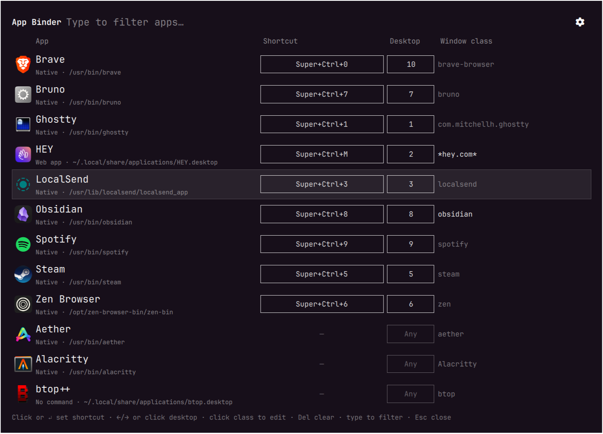
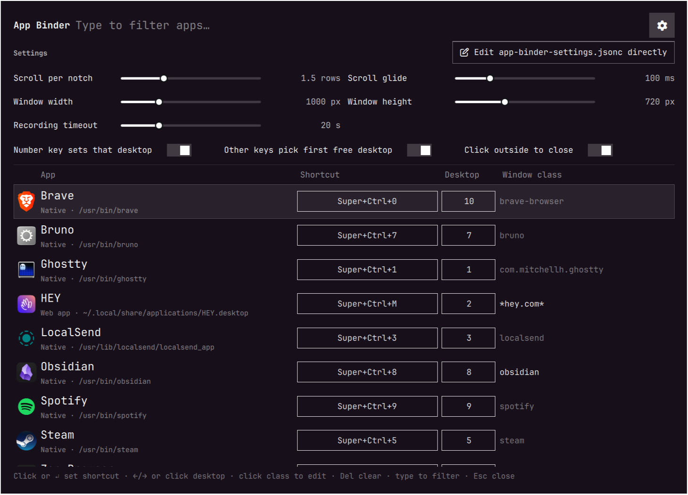

# App Binder

One key per app. Press it and the app comes forward if it's running, or launches if it isn't.

App Binder is an [Omarchy](https://omarchy.org) shell plugin for the macOS/Raycast habit of jumping straight to an app by keyboard. You choose the keys. For example, you might use `Super+Ctrl+1` for your terminal or `Super+Ctrl+M` for mail. A shortcut doesn't mean "go to a desktop and hope the app is there". It means "I want that app", wherever it is.

Assign shortcuts in a table of every installed app: click a row, press the combo, done.



## What a shortcut does

- **App running:** switches to the desktop its window is on and focuses it. If it has several windows, it goes to the most recently used one. It never opens a second copy.
- **App not running:** switches to the app's desktop (or the first empty one), then launches it there.

## Features

- **Table of every installed app**, using the same list as Omarchy's app launcher, with icons. Bound apps sort to the top. Type to filter.
- **Tells look-alike apps apart.** Under each name: its type (Native, Flatpak, Web app, AppImage, Terminal app, Steam game, Heroic game) and where it lives, e.g. `Native · /usr/bin/discord` next to `Web app · ~/.local/share/applications/Discord.desktop`. Click it to copy the path. That's handy for removing a duplicate install. Entries whose program no longer exists are flagged **Broken**. You can also filter by type or path ("flatpak", "web app", "/opt").
- **Press-to-record shortcuts.** Click a row (or press Enter), then press the combo. While it records, your other Hyprland shortcuts are briefly paused, so even a combo that's already in use reaches the recorder instead of firing.
- **Conflict warnings.** If a combo is already bound, App Binder shows what it does now. Press Enter to take it over or Esc to pick another. A combo moved from another App Binder row is removed from that row.
- **A desktop per app.** Choose `Any` (first empty desktop) or 1–10.
  - A shortcut ending in a number key sets that desktop: `Super+Ctrl+4` puts the app on desktop 4.
  - A shortcut ending in any other key picks the lowest desktop no other app uses.
  - Desktops you choose by hand are kept when you re-record a shortcut.
- **Window matching** by Hyprland window class. App Binder fills in a sensible default (the app's `StartupWMClass`, or its desktop-entry ID). You can edit it, use `*` wildcards (e.g. `*hey.com*` for a web app), or pick from the classes of currently open windows.
- **Settings panel** behind the cog: sliders and switches, plus a button to edit the settings file directly.
- **Matches your Omarchy theme.** It uses Omarchy's own shell components (the same rows, sliders and switches as the built-in panels).

## Requirements

- Omarchy 4 ("Quattro"), which uses the Lua Hyprland config and the Quickshell-based Omarchy shell. Tested on Omarchy 4.0.0.
- Hyprland 0.56 or newer. Tested on 0.56.2.

## Install

```bash
omarchy plugin add https://github.com/casey-cantcode/app-binder --enable
```

That's all: no Hyprland config to edit. Open App Binder with **Super+Ctrl+Alt+Space**. If you already use that combo for something else, your binding is kept and both will fire. Rebind one of them.

## Usage

| Do this | What happens |
|---|---|
| Type | Filters the app list |
| Click a row, or Enter | Records a shortcut for that app |
| Esc while recording | Cancels |
| Backspace while recording, or Del | Clears the app's shortcut |
| Click the Desktop cell, or ←/→ | Cycles `Any`, 1–10. Right-click cycles backwards |
| Click the Window class cell | Edits the match; open windows' classes appear as clickable chips |
| Cog | Shows or hides Settings |
| Esc, Super+Ctrl+Alt+Space, or click outside | Closes App Binder |

To open App Binder from a script or your own keybinding, with Settings showing or the list pre-filtered:

```bash
omarchy-shell shell summon cantcode.app-binder '{"settings": true}'
omarchy-shell shell summon cantcode.app-binder '{"filter": "discord"}'
```

## Settings



Change these with the cog, or edit `~/.config/omarchy/app-binder-settings.jsonc` directly (JSON with `//` comments). Saved changes apply immediately. Delete the file to restore the defaults.

| Setting | Default | Description |
|---|---|---|
| `scroll_rows_per_notch` | `1` | Rows the list scrolls per mouse-wheel notch |
| `scroll_glide_ms` | `140` | Length of the scroll glide in ms; `0` = jump instantly |
| `window_width` / `window_height` | `1000` / `720` | Largest window size; it shrinks on smaller screens |
| `capture_timeout_seconds` | `20` | How long recording waits for a shortcut |
| `auto_desktop_number_keys` | `true` | A number-key shortcut sets that desktop |
| `auto_desktop_other_keys` | `true` | Any other shortcut picks the first unused desktop |
| `close_on_click_outside` | `true` | Clicking outside closes App Binder. When `false`, other windows stay clickable while it's open |

## Dependencies and what it touches

Everything it needs ships with Omarchy 4: `hyprctl`, `uwsm-app`, `gtk-launch` (GTK 3), `omarchy-launch-editor` and `omarchy-shell`. No extra packages.

App Binder writes only its own files:

- `~/.config/omarchy/app-binder.json`, your shortcuts
- `~/.config/omarchy/app-binder-settings.jsonc`, settings
- `~/.config/omarchy/app-binder-data.lua`, generated for Hyprland

It never edits `hyprland.lua` or any other config file. Its shortcuts are added to the running Hyprland with `hyprctl eval` (see How it works). After a change it runs `hyprctl reload`. While recording a shortcut it briefly switches Hyprland to an empty keybinding submap (see Troubleshooting). It only replaces an existing Hyprland binding when you confirm the conflict prompt.

## How it works

| File | Role |
|---|---|
| `AppBinder.qml` | The window (an Omarchy shell overlay plugin) |
| `hypr/app-binder.lua` | Hyprland side: turns each saved row into a binding with the focus-or-launch logic |
| `scan-apps.sh` | Classifies each desktop entry (type and location) for the second line under app names. Read-only |
| `~/.config/omarchy/app-binder.json` | Your shortcuts. App Binder writes this; it's the source of truth |
| `~/.config/omarchy/app-binder-data.lua` | Generated from the JSON for Hyprland to read. Don't edit by hand |

App Binder loads with the Omarchy shell at login and runs `hypr/app-binder.lua` inside Hyprland with `hyprctl eval`. That registers your shortcuts as ordinary Hyprland bindings (described as `App Binder: <app>`), so they work whether or not the window is open, and appear in Omarchy's keybindings list.

A Hyprland config reload clears bindings added this way, so App Binder listens for Hyprland's `configreloaded` event and adds them again. Running the script twice never duplicates anything: it removes the bindings it made last time first. When you change something in App Binder, it writes both files and runs `hyprctl reload`, which also restores any default binding a removed shortcut had replaced.

Apps launch the same way Omarchy's launcher starts them: `uwsm-app -- gtk-launch <app>.desktop`.

### Multi-monitor desktops (optional)

By default a "desktop" is a plain Hyprland workspace. If your setup treats a desktop as a set of workspaces across several monitors, provide a Lua module at `~/.config/hypr/linked-desktops.lua` that returns a table with these functions, and App Binder will use them:

| Function | Purpose |
|---|---|
| `switch(n)` | Show desktop `n` |
| `focus_window(win)` | Bring up the desktop holding `win` (a Hyprland window object) and focus it |
| `first_empty()` | Return the lowest empty desktop number, or `nil` |

## Troubleshooting

- **The shortcut launches a second copy instead of focusing.** The window class doesn't match. Open the app, click its Window class cell in App Binder, and pick the right class from the open-window chips. Web apps usually need a wildcard such as `*hey.com*`.
- **Keyboard shortcuts stopped working while recording.** Recording pauses Hyprland's shortcuts, and they come back automatically after the recording timeout. To restore them immediately, press **Super+Ctrl+Alt+Shift+Esc**.
- **Shortcuts missing after login or a crash.** They're installed by the Omarchy shell, which also runs your bar. Run `omarchy restart shell` and they're added again.
- **Edits to `AppBinder.qml` don't show up.** App Binder stays loaded for the whole session, so it doesn't hot-reload. Run `omarchy restart shell`.

## Uninstall

```bash
omarchy plugin remove cantcode.app-binder
```

Its shortcuts stay active until the next Hyprland config reload or login, then they're gone. Run `hyprctl reload` to drop them right away. Optionally delete `~/.config/omarchy/app-binder.json`, `~/.config/omarchy/app-binder-settings.jsonc` and `~/.config/omarchy/app-binder-data.lua`.

## Changelog

See [CHANGELOG.md](CHANGELOG.md). App Binder follows [Semantic Versioning](https://semver.org).

## License

[MIT](LICENSE) © Casey Sorrells
